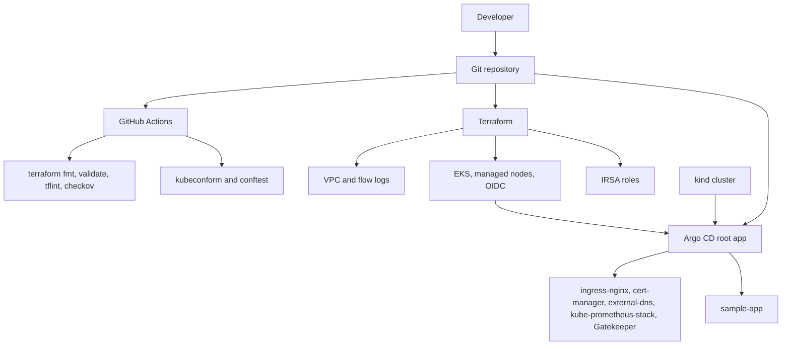

# GitOps Kubernetes Platform

Portfolio project for Martin Couso. It is a working layout for an AWS EKS cluster defined in Terraform and a Kubernetes platform installed by Argo CD. GitHub Actions checks formatting, Terraform, rendered manifests, and a small set of policy tests.

Nothing in this repository has been applied to a cloud account. CI does not have cloud credentials and does not run `terraform apply` or `helm install` against a live cluster. Numbers below are configuration, not measurements from a running system.

## Architecture

Terraform builds the network, the EKS control plane, a managed node group, and IAM roles for service accounts. Argo CD then syncs the platform and a sample app from this repo. A kind cluster can run the same Argo CD app-of-apps without AWS.



GKE is an optional stack under `terraform/environments/gke`. It is validated in CI and is not wired as a second GitOps cluster.

## Repository layout

```text
terraform/
  modules/vpc          Wrapper around terraform-aws-modules/vpc/aws 6.7.3
  modules/eks          Wrapper around terraform-aws-modules/eks/aws 21.29.0
  modules/irsa         IRSA roles for external-dns, cert-manager, and the EBS CSI driver
  modules/gke          Optional wrapper around terraform-google-modules/kubernetes-engine 47.0.0
  environments/dev     Public API locked to caller-supplied CIDRs, single NAT gateway
  environments/prod    Private API endpoint, one NAT gateway per AZ, deletion protection
  environments/gke     Optional regional private-node GKE cluster
  bootstrap/remote-state
                       Optional encrypted S3 state bucket, replica, and lockfile settings
gitops/
  bootstrap/           Root Argo CD Applications for dev, prod, and local
  argocd/              AppProjects and Application manifests
  clusters/            Kustomize entrypoint per environment
  platform/            Helm values, issuers, storage class, Gatekeeper policies
  workloads/sample-app Kustomize overlays for local, dev, and prod
local/                 kind config and bootstrap scripts
policy/                Conftest policies and unit tests
scripts/               Render, schema checks, and tool install
.github/workflows/ci.yml
```

Pinned add-on charts:

| Add-on | Chart | Version |
| --- | --- | --- |
| ingress-nginx | ingress-nginx | 4.15.1 |
| cert-manager | cert-manager | v1.21.3 |
| external-dns | external-dns | 1.23.0 |
| monitoring | kube-prometheus-stack | 93.1.1 |
| Gatekeeper | gatekeeper | 3.23.1 |

EKS Kubernetes version in the examples is 1.36. The kind node image is Kubernetes 1.37.0, which is the image published with kind v0.33.0. Argo CD in the local script is v3.6.1.

## Local quickstart

Requirements: Docker, git, kind v0.33.0, and kubectl. The bootstrap does not need AWS or GCP credentials.

```bash
INSTALL_CLUSTER_TOOLS=1 ./scripts/install-ci-tools.sh "$HOME/.local/bin"
export PATH="$HOME/.local/bin:$PATH"
make local-up
```

`make local-up` creates a kind cluster named `gitops-platform`, installs Argo CD, starts a git daemon inside the cluster, pushes the current commit to it, and applies `gitops/bootstrap/root-local.yaml`. Only committed files are pushed. After later commits, run `make local-sync`.

Host ports 8080 and 8443 must be free. They map to ingress-nginx on the kind node.

```bash
kubectl -n argocd port-forward svc/argocd-server 8444:443
kubectl -n argocd get applications
```

The initial admin password is printed by the bootstrap script and is also stored in the `argocd-initial-admin-secret` secret. The UI is `https://localhost:8444`.

When the sample app is synced, open `http://sample.localtest.me:8080`. `localtest.me` is a public DNS name that resolves to `127.0.0.1`. You can use an `/etc/hosts` entry instead.

`make local-down` deletes the kind cluster.

external-dns is not synced locally. It needs a DNS provider account, and a fake provider would crash. Its chart is still rendered in CI. Grafana's admin password in git is the placeholder `change-me`.

## Cloud deployment

Do this only in an account you control. Replace every placeholder before you apply or sync. The AWS account id `111122223333` and the hosted zone id `Z00000000000000000000` are examples, not a target.

1. Optional remote state. Copy `terraform/bootstrap/remote-state/terraform.tfvars.example` to `terraform.tfvars` (gitignored) and choose a globally unique bucket name of at most 50 characters, using only lowercase letters, numbers, and hyphens. Then:

   ```bash
   terraform -chdir=terraform/bootstrap/remote-state init
   terraform -chdir=terraform/bootstrap/remote-state plan
   terraform -chdir=terraform/bootstrap/remote-state apply
   ```

   The stack creates a KMS-encrypted, versioned S3 bucket, a cross-region replica, access logging, and a TLS-only bucket policy. Copy `backend.hcl.example` to `backend.hcl` in the environment you are deploying and fill in the bucket name and KMS key ARN from the outputs. The backend uses Terraform's S3 lockfile (`use_lockfile`), so there is no DynamoDB table. CI never reads `backend.hcl`. It runs `terraform init -backend=false`.

2. Copy `terraform/environments/dev/terraform.tfvars.example` or the prod file to `terraform.tfvars`. Set `api_access_cidrs` to your network. `0.0.0.0/0` is rejected by a variable validation. Set `route53_zone_arns` to a hosted zone you control.

3. Review the plan and apply it yourself:

   ```bash
   terraform -chdir=terraform/environments/dev init -backend-config=backend.hcl
   terraform -chdir=terraform/environments/dev plan
   terraform -chdir=terraform/environments/dev apply
   ```

   Prod keeps the Kubernetes API private (`endpoint_public_access = false`), uses one NAT gateway per availability zone, and turns on deletion protection. You need a network path to the private endpoint before `kubectl` works.

4. Configure kubectl:

   ```bash
   aws eks update-kubeconfig --region us-east-1 --name gitops-dev
   ```

5. Install Argo CD v3.6.1, then edit the GitOps values before the first sync:

   - `gitops/platform/external-dns/values-dev.yaml` and `values-prod.yaml`: role ARN from `external_dns_role_arn`, and a domain you control.
   - `gitops/platform/cert-manager/values-dev.yaml` and `values-prod.yaml`: role ARN from `cert_manager_role_arn`.
   - `gitops/platform/platform-config/components/letsencrypt/issuers.yaml`: email address and Route 53 region.
   - `gitops/workloads/sample-app`: hostnames. Prod uses the `letsencrypt-prod` issuer. Let's Encrypt will not issue a certificate for `example.com` unless you control that name.
   - `gitops/platform/namespaces/namespaces.yaml`: replace the Grafana password. The monitoring chart reads the secret `grafana-admin-credentials`.

   If you keep the default cluster names `gitops-dev` and `gitops-prod`, the role names in the values files match the Terraform names. The account id does not.

6. Push the commit Argo CD should read. `gitops/bootstrap/root-dev.yaml` and `root-prod.yaml` track `main` on `https://github.com/martincouso-star/gitops-kubernetes-platform`. Change `targetRevision` if you want a different branch.

   ```bash
   kubectl apply -f gitops/bootstrap/root-dev.yaml
   kubectl -n argocd get applications
   ```

The EBS CSI add-on is installed by Terraform, not by Argo CD. Dev and prod ship a `gp3` StorageClass for it. Prod Prometheus asks for a 50Gi volume on that class. Dev Prometheus does not request a persistent volume.

### Optional GKE

`terraform/environments/gke` is a separate sketch. It creates a custom VPC, Cloud NAT, and a regional private-node cluster with the upstream private-cluster module. Copy `terraform.tfvars.example`, set a real project id, and enable billing for `compute.googleapis.com`, `container.googleapis.com`, and `iam.googleapis.com` (the stack also requests those APIs). The default authorized network is the documentation range `203.0.113.0/24`. There is no GKE-specific Argo CD overlay; the same manifests can be pointed at a GKE cluster later.

## Policy and security

Terraform defaults that are easy to get wrong, and how this repo sets them:

- Worker nodes sit in private subnets. Public subnets are tagged for load balancers.
- Dev uses one NAT gateway. Prod uses one per availability zone.
- The EKS API is private, and on dev it is also public to the CIDRs you set. Prod leaves the public endpoint off.
- Control plane logs (api, audit, authenticator, controllerManager, scheduler) go to CloudWatch. Kubernetes secrets are encrypted with a KMS key that has rotation enabled.
- Node IMDS requires tokens. Root volumes are encrypted gp3.
- VPC flow logs are enabled.
- external-dns, cert-manager, and the EBS CSI controller use IRSA roles scoped to the hosted zones you pass in. No static cloud keys are stored for them.
- The sample app runs as a non-root user, drops capabilities, sets a read-only root filesystem, and has requests, limits, and probes. Its NetworkPolicy allows ingress only from the `ingress-nginx` namespace.

Gatekeeper is installed with four example policies: required `app.kubernetes.io/name` labels, no privileged containers, no `:latest` or untagged images, and readiness plus liveness probes on Deployments, StatefulSets, and DaemonSets. Platform namespaces (including `kube-system`, `argocd`, `ingress-nginx`, `cert-manager`, `monitoring`, and `gatekeeper-system`) are excluded, because the upstream charts are not written to satisfy those rules. The policies do apply to `sample-app`. They are examples, not a complete admission policy, and they do not replace Pod Security Admission.

Conftest checks the rendered sample app for the same kinds of issues, and `policy/kubernetes_test.rego` checks that a bad manifest is rejected. kubeconform checks rendered Helm and Kustomize output. CustomResourceDefinitions are skipped because their OpenAPI is often too large or absent from the schema catalog. Gatekeeper constraint kinds are skipped for the same reason; the ConstraintTemplates are validated.

Checkov scans the Terraform we write and does not download the upstream modules into the scan. `CKV_TF_1` is skipped because those modules are pinned to an exact registry version rather than a git commit. The state KMS key policy grants the account root `kms:*` so the key cannot be locked out, which trips `CKV_AWS_109`, `CKV_AWS_111`, and `CKV_AWS_356`. The access-log bucket is not replicated; the state bucket is.

Do not commit `terraform.tfvars`, `backend.hcl`, kubeconfigs, or cloud credentials. Those paths are gitignored.

## CI

`.github/workflows/ci.yml` runs `make ci`:

- `terraform fmt -check`
- `terraform init -backend=false` and `terraform validate` for dev, prod, GKE, and the remote-state stack
- `tflint` with the AWS ruleset
- `checkov`
- `helm template` and `kustomize build`, then `kubeconform`
- `conftest verify` and `conftest test` on the sample app

Tool versions are pinned in `scripts/install-ci-tools.sh`.

## Roadmap

- Point prod and dev at a real domain, and stop using the example account id in the values files once a cluster exists.
- Install External Secrets or SOPS instead of the Grafana placeholder secret.
- Pin container images by digest.
- Add ServiceMonitors after the Prometheus Operator CRDs are in place. They are left off so the first sync does not depend on CRD ordering.
- Cover platform namespaces with policy, or switch the exceptions to a narrower exempt label.
- Add Pod Security Admission labels on namespaces.
- ApplicationSets for more than one cluster, including the GKE stack.
- Karpenter or an additional node group, and a backup tool such as Velero.
- Alerts that mean something for a workload you actually run. This repo does not ship fake SLO numbers.
